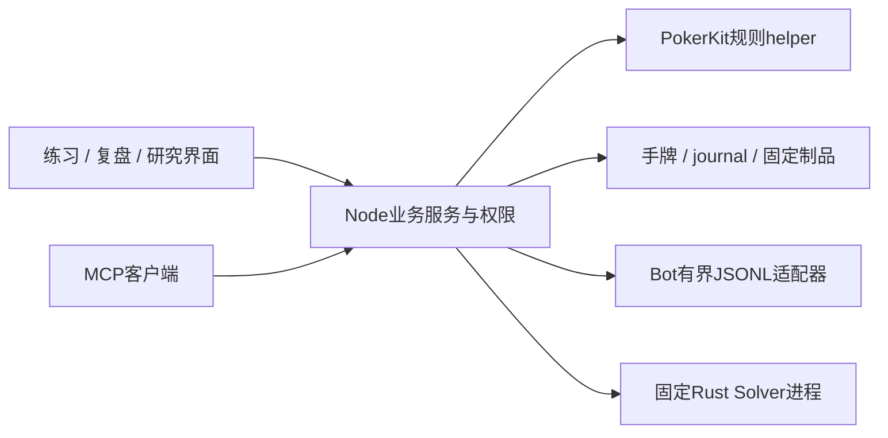

# 当前架构与组件边界

## 唯一业务权威

产品拥有手牌事实、座位/金额映射、规则提交、工作区、作业发布、保存恢复和答案暴露。Bot只返回行动提议；Solver只处理给定规格的计算/查询。UI和MCP调用同一业务命令。

| 项目/目录 | 权威职责 |
| --- | --- |
| 产品 `src/modules/play`、`runtime/game` | 练习/复盘、规则适配、Bot监督、原决定前缀和自动报告 |
| 产品 `src/modules/analysis`、`runtime/analysis` | 研究UI、规格/质量/作业/制品发布、来源与范围业务管理 |
| 产品 `runtime/engines` | 进程监管、身份/哈希验证与有界读取适配 |
| Bot `submission/hu_bot`、`adapters/riverline` | 独立策略核心及产品/平台边界 |
| Solver `engines/postflop`、引擎schema与基准 | 引擎薄适配、原生协议/计算/查询和独立数值门 |

## 固定组件快照

[组件锁](../components.lock.json)列出仓库、精确提交及逐文件映射/摘要。产品包含兼容快照，不自动追踪组件main；`npm run components:check`检测漂移。可加 `--bot=../riverline-bot --solver=../riverline-solver`核对本机源提交及内容。相关变更先在源仓开发，再集成产品。

业务服务没有拆成多个网络服务，也没有搬入第二套规则/数据库权威。`business.schema.json`属于产品；引擎输入/worker/节点schema属于Solver，详见[合同入口](../contracts/solver/README.md)。

## 必须保持的语义

- Bot只接收自己私牌与当时公开前缀；未来公牌、其他玩家底牌和隐藏诊断不得进入决策。
- 金额使用声明单位的整数，区分raise-to总额、本次增投与沉没成本；HU BTN/SB与六人背景桌型不混用。
- 事实、手工假设、Bot估计、外部策略和真实解分别有来源。输入与结果固定版本，输入修改不改写旧解。
- 真实EV按当前节点原点解释；范围不匹配、原动作离树、路径不可达或质量不足不能补值。独立局部模型不构成整手损失。
- 计算/读取共享有界资源；取消、超预算、中断与完成分别记录。原生大树不进入快照或Agent上下文。
- 旧报告v1及引擎schema1–4保持原义；schema5翻牌用显式kind区分，不借兼容容器重解释旧数据。

旧Python/Next项目按[采用分析](poker-agent-adoption.md)逐模块接入；未来解释器消费只读证据，比赛日志先转换/验证后导入。
