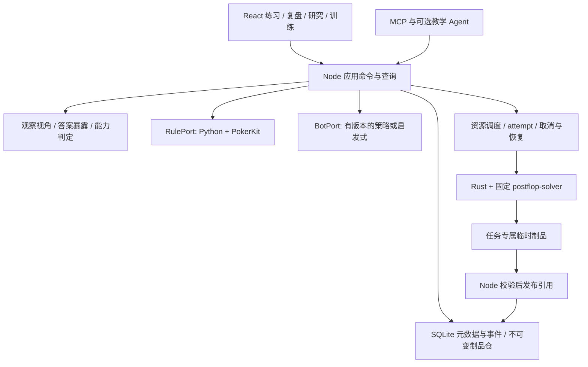

> 历史记录：整理前的设计/交付状态，不作为当前开发指令。当前能力见[最新状态](../../current-status.md)；原始版本可从Git提交 `f416438` 追溯。

# Riverline 统一运行时、数据与部署架构 v0.1

执行更新：第一轮已采用 Node 唯一业务服务、Python/PokerKit 0.7.8 helper、原固定 Rust Solver、练习SQLite与构建后同端口静态页面，见 [实际安装/运行与边界](riverline-first-round-delivery-2026-11-25.md)。研究仍使用既有journal/blob，旧课程仍保留浏览器存储；尚未实施全部存储迁移、Linux镜像或桌面包。下文为目标架构和原采用门，不代表全部部署已完成。

日期：2026-11-25。状态：设计决策与待验证采用条件；没有安装新依赖、迁移数据库或部署。产品入口：[统一方案](riverline-unified-product-architecture-2026-11-25.md)。既有 [真实引擎设计](solver-real-codebase-design.md) 中已验证的进程协议、固定引擎和按需读取继续承接。

## 1. 推荐架构与替代方案

采用模块化 Node 应用服务为唯一业务权威，React 浏览器工作区，Python/PokerKit 规则 helper，Rust Solver 计算进程。多语言用于复用成熟内核，不等于三个独立业务后端。首版一台机器、一个业务写入口、一个工作区存储；规则和计算进程不直接访问业务数据库。



| 备选 | 结论 | 代价与再评估条件 |
|---|---|---|
| 保留旧 Python/FastAPI 为全部业务中心 | 不作为本次默认 | 需要把本仓库已接入的 Node/MCP、作业、制品和真实分析反迁；旧课程仍需独立迁移 |
| 全部改写 TypeScript 规则和求解 | 不采用 | 重写成熟规则及 CFR 会扩大正确性负担；违背理解与复用方向 |
| Node + 无业务存储的 Python/Rust helper | 推荐，带采用门 | 规则协议、Python 分发、跨语言 schema 和性能都需 spike 证明；失败后记录替代 ADR，不形成双写 |
| 合并两个业务服务，各管一部分用户状态 | 不采用 | 会造成身份、事务、曝光账本、作业及备份权威分裂 |
| 浏览器内 WASM 作为主求解 | 后置评估 | 不承担当前长任务、关闭网页恢复和内存隔离主路径 |
| 先做 Tauri/Electron 外壳 | 后置 | 外壳不解决当前领域和稳定性问题；安装体验明确需要时评估 |

本次选择 Node 的依据是用户明确要求与本仓库整合。上轮针对旧仓库的“先保留 Python 业务层”建议适用于旧仓库单独重构；当前通过保留 Python 规则内核而统一 Node 业务层承接新范围。

## 2. 技术栈与版本政策

| 部分 | 选择 | 当前事实 / 待完成 |
|---|---|---|
| UI | React + TypeScript strict + React Router + Vite 构建 | 沿用现有 lock，不在设计批次升级；Vite 只用于开发与构建 |
| 状态 | 服务端查询缓存、Zustand 交互/草稿、局部 UI state | 不把服务端对象复制为第二份可写权威；首个迁移切片提取查询缓存后再判断是否引入专门库 |
| 样式/图形 | CSS Modules + 语义 HTML + DOM/SVG | 设计 token 和组件契约集中；不引入 Three.js 为默认依赖 |
| 应用 | Node 24 系列，版本锁定与补丁升级单独验证 | 本机实测命令为 v24.15.0，不声称最新安全版本；发布时核对受维护补丁 |
| 本地元数据 | SQLite，首选验证 `node:sqlite`，通过 StoragePort 隔离 | v24.15.0 文档标 Release candidate；先验证事务、忙超时、恢复、备份和打包，再确定依赖 |
| 规则 | Python + 固定 PokerKit，复用旧薄适配 | 旧仓库曾使用 Python 3.13；本机 `py -0p` 仅列 3.14，本次未验证兼容。采用门固定其一并锁依赖，不能把旧测试当当前通过 |
| 求解 | Rust 1.85.1 + 已固定完整 postflop-solver | 维持现有脚本/lock/feature，不用根 cargo 默认工具链绕过 |
| 合同 | JSON Schema + TS 边界校验 + Python/Rust 对应校验 | wire DTO 与 UI/领域/原生结构分别映射，黄金样例跨语言验证 |
| 验证 | Vitest、Node 合同测试、Playwright、Python 规则测试、Rust 数值基准 | 按风险/旅程组合运行，不给低风险文档改动跑整版计算 |

`node:sqlite` 为同步 API；首版短事务通过单写存储端口，避免在事务内运行规则重放或 Solver。事件循环延迟实测超标时把连接与串行消息队列放入专属 worker；备选驱动必须通过相同存储合同，不能为了名称“原生”忽略运行风险。

## 3. 目录与依赖边界（拟）

```text
contracts/{game,study,learning,solver}/    公共命令/查询、版本与黄金样例
runtime/{game,review,study,learning}/      应用服务；逐次从现有 service 抽离
runtime/storage/                         事务、schema 迁移、导入、备份
runtime/engines/                         RulePort / SolverPort / BotPort 适配
engines/rules/                          Python helper、固定依赖、来源及规则基准
engines/postflop/                       现有 Rust workspace，保持固定
src/modules/{play,review,analysis,teaching}/
src/shared/{cards,matrix,actions,layout}/  跨工作区一致的产品组件
tests/{contracts,journeys,storage}/
benchmarks/{rules,solver,experience}/
```

目录随首条纵向切片创建，不先铺空壳。UI 和 MCP 访问相同命令；Python/Rust 不能反向调用 UI，公共产品模型不依赖 PokerKit 类型或引擎索引。

## 4. 规则调用、幂等和故障

RulePort 拟用常驻 Python helper，经长度受限 JSONL stdin/stdout 通信，不开放第二 HTTP 业务 API。握手返回规则库/协议/构建版本。首版计算纯输入：初始规则、受保护发牌事实、已提交动作前缀与待尝试行动；返回合法动作、账本、终局与本次建议追加事件。Node 校验预期序号后一次事务提交事件、会话 revision、command receipt 和待处理投影记录。

规则合法性只由 PokerKit 适配判定；Node 的协议结构、身份、幂等和存储校验不是第二规则实现。发牌由 Node 持久化受保护随机源/确定牌序输入；Python 按输入验证并推进，重放不能重新随机。需要自动发牌时，先形成明确的 deal intent，再以同一规则适配验证，不能两端各自补牌。

每个会话串行提交，跨会话可排队；Python helper 可缓存纯重放结果，但它的内存不是唯一状态。规则进程异常：该命令无提交、用户行动保留并可重试；同 commandId 不重复行动。响应因 expectedRevision 失配被拒绝时重新查询，不自动应用到新决策。

首版用前缀重放证明正确性并测耗时。不要预设 PokerKit 对象可跨版本序列化；若需 checkpoint，另验证格式、版本、恢复一致性与可失效缓存规则。无法达到交互预算时，先调整 helper 生命周期/投影缓存，再评估替代适配，不自行补写边池规则。

Bot 只接 actor 自己的合法 Observation。求解、画像和 LLM 失败不阻塞牌局；Bot 超时按明确的合法保底政策行动并记录来源，不能随机改变用户 action。对手风格与模型版本在每手固定，不能中途静默替换。

## 5. 存储、事件与旧数据迁移

整手练习补充：训练定义/作答以 hand-level 对象聚合逐节点 Attempt，保存初始条件、实际路径、合法终局、暂停/恢复与提示时序。手后报告关联每个决策自己的分析/覆盖，不能强制要求所有街道已有真解才保存完整手牌。深度研究将整手来源与各街局部 StudyRevision/AnalysisSpec 分别引用，跨街派生保留条件和上游版本，不将多个局部结果伪装成一个全局解。

本仓库 `DiskStore.commit` 当前把完整状态写入每条 journal，适合现阶段小工作区，但不适合持续牌局增长。目标结构是事务元数据/事件 + 内容寻址 blob，不把整个研究树写入快照。

拟定表族：workspaces、game_sessions、hands、hand_events、command_receipts、decision_snapshots、issues、study_revisions、range_revisions、policy_revisions、analysis_specs、job_attempts、solution_manifests、findings、exercise_definitions、attempts、exposures、outbox、projection_cursors、imports、schema_migrations。

关键约束：`(workspace_id,command_id)` 唯一；`(hand_id,seq)` 唯一；每个 revision 有输入哈希；artifact 引用含摘要与 readerVersion。业务命令事务提交事实与 outbox；投影可重建，重试以消费者/源事件身份幂等。进度采样不逐次进入业务大快照；终态和重要生命周期持久化。

可见公开事实与 server-only 私牌/随机源分表或独立封装；查询投影必须白名单字段。独立作答时私牌、未来、参考解和预计算反馈都不能进浏览器、MCP 或导出资源，再用 CSS 隐藏。查看答案先提交曝光事务再返回正文；MCP 与 UI 使用同一会话模式，不能通过另开工具上下文绕过。

迁移步骤：

1. 只读导出当前 Node journal、blob 索引及浏览器课程备份；保存原件和校验值。
2. dry-run 生成对象/版本/来源/暴露映射与拒绝清单；unknown exposure 保持 unknown。
3. 导入新 SQLite 工作区，先验证引用闭包、数目/哈希、固定解 reader 和作答身份；新 ID 保留 sourceRef，不猜合并同名案例。
4. 新界面在单一存储后端上运行一次真实闭环；切换通过后旧数据继续只读。回退到独立旧数据副本，不反向双写。
5. 旧 Riverline 通过白名单版本化 hand/review 导出适配导入，禁止直接拼表；不搬旧 solver 临时缓存冒充新制品。

SQLite WAL 仅放本机磁盘，不放 SMB/云盘同步目录作为活库。备份采用 SQLite 在线备份/一致快照并带 artifact manifest，做离线恢复验证；不能运行中只复制主 `.db` 忽略 WAL。垃圾回收只清理无引用且超过保留期的 blob，先 dry-run。

## 6. 研究、任务和缓存

研究提交固定完整 AnalysisSpec：范围、具体树、金额与价值模型、输入来源、计算目的、引擎版本及质量目标。semantic hash 与执行 attempt 分开。缓存只在语义/质量兼容时命中；花色置换须同时变换整个问题并保留逆映射，禁止只按牌面、底池桶或街道复用精确结果。

Rust 每个计算 attempt 一个独立进程，先一个计算槽。查询与计算共同计入内存预算；完成解先按校验的只读分页接口访问。worker 只写任务目录，Node 验证完整性和摘要后发布不可变制品引用。失败/取消/强制中断分开；没有验证 checkpoint 就只提供重试，不提供“从进度继续”。

当前 256 MiB 解码/估算与 120 秒的小树限制不是未来全范围性能承诺，也不是操作系统硬 RSS 隔离。Windows Job Object/Linux cgroup 或等效硬限制属于后续运行 spike；超额前预检、达到限制终止并保留诊断。先测本机资源再决定并发，不按逻辑核数自动开多个大树任务。

预解目录只存合法拥有的真解，带完整规格、引擎、质量和许可。商业产品公开帮助不等于允许获取其付费数据库或二进制解格式。不得为追求商业体验自动抓取商业解库。

## 7. 运行与部署阶段

| 形态 | 进程与数据 | 开放门 |
|---|---|---|
| Windows 本地源码开发 | Vite + Node；受控 Python/Rust；明确数据目录与本机端口 | 当前主要环境；版本锁、诊断启动器、真实闭环 |
| Windows 本地日常使用（首选产品形态） | Node 同端口提供构建后 SPA/API；启动器托管 helper；SQLite + artifacts | 静态构建 smoke、端口/PID 所有权、重启恢复、资源/许可验收；不依赖 Vite dev server |
| Linux 单用户自托管 | 相同服务边界；CPU 容器/卷；反向代理与认证按暴露方式加入 | Rust/Python 跨平台构建和恢复单独验收，目前未验证，不称 Docker ready |
| 多用户托管（后续） | tenant-aware API、PostgreSQL、对象仓、独立 worker、配额与访问控制 | 隔离/鉴权/迁移/备份/成本门通过后开放；不能将本地 SQLite 用共享卷直接扩成 SaaS |
| 桌面安装包（后续） | 可选轻量外壳/捆绑运行时 | 原生依赖、Python/Rust 分发、签名/更新/回退、许可源代码提供门；不是当前已交付能力 |

默认本地监听 loopback，静态资源和 API 同源；本地变更接口校验 Origin/Host 与启动会话令牌，禁止任意网页跨源驱动本机牌局。仅本机使用不要求注册；远程访问不得直接暴露这一无账号模式。外部 LLM 为可选能力，key 不进前端包、备份和普通日志，模型失败回到受约束说明。

生产式本地运行的浏览器关闭不停止求解，前端故障不终止 Node；显式停止服务才中断当前 attempt 并保存可恢复状态。开发启动器目前的 Vite `0xC0000409` 仍无已证明根因，须保存失败对照，比较 Vite 与构建后服务，不靠一次隔离通过宣布修复。

## 8. 性能与容量预算（拟定验收目标，未实测）

参考机器在 U00 记录 OS/CPU/RAM/磁盘/精确版本，不以本文件的目标冒充结果。

| 操作 | 目标 | 测量方式 |
|---|---|---|
| 无计算的行动提交与安全投影 | 本机 p95 ≤ 150ms | 规则 helper 已热身，1000 次合法/冲突调用，另记冷启动 |
| 已缓存节点/矩阵查询 | p95 ≤ 200ms | 固定解大小/冷热状态/分页上限，记录 p99 |
| 本地首个可行动界面 | ≤ 3s | 构建后 SPA；服务 ready 与浏览器首屏分别计时 |
| 求解时行动/取消/查询 | UI 主线程无 >100ms 的应用长任务；取消请求 p95 ≤ 200ms | Playwright/性能采样，取消最终停止另计，不能把收到请求当已停止 |
| 事件增长 | 1 万手元数据/分页可读，避免全工作区重写 | 合成负载仅用于工程容量；不当扑克质量证明 |

真实求解时长不设统一秒数承诺；每个开放规格给预估范围、预算、实际迭代/质量与取消方式。查询首开原生解耗时超标时实测常驻 reader 和有界缓存，再决定优化。

## 9. 来源与发布限制

- [Node v24.15.0 SQLite 文档](https://nodejs.org/download/release/v24.15.0/docs/api/sqlite.html)：此版本为 Release candidate，DatabaseSync 同步；不能据最新版网页反推当前版本行为。
- [SQLite WAL](https://www.sqlite.org/wal.html)：单主机限制、checkpoint 和备份设计依据；发行构建核对内嵌 SQLite 的具体修复版本。
- [PokerKit 官方文档](https://pokerkit.readthedocs.io/en/stable/)：Python 规则/状态机依赖的采用依据；稳定站点不是本项目锁版本，仍须冻结实际版本并重验。
- 旧 Riverline 为 AGPL 路线，本项目 Rust 上游亦有 AGPL 义务；newHoldem 为非商业许可。进程隔离不是许可豁免。代码、可执行文件、容器/安装包和服务的来源/通知/所需源码逐项核对；本次不改变仓库许可，不宣称可闭源商业分发。
- 本批没有安装或验证 Python helper、SQLite 驱动、容器、安装包和多用户设施；采用门与开发任务见 [实施计划](riverline-unified-implementation-plan-2026-11-25.md)。
