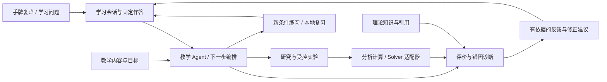
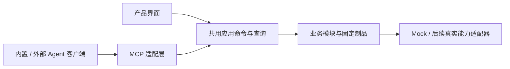

# 产品功能模块划分 v0.2

日期：2026-11-12。状态：整体产品设计建议稿，未实施本次模块重组。v0.1 由用户“拆分一下功能模块”形成，v0.2 根据“为什么不是所有功能都集成为 MCP 可以供 Agent 调用”补充完整 Agent 工具面；不改变 `baseline/teaching-t1.0` 的交付范围和结果。本文不把源码文件夹、导航页面、外部 Solver 品牌或 Agent 名称直接当成业务模块。

目标：把扑克局面与策略分析能力，转换成能围绕真实用户判断进行解释、纠错和迁移检验的教学过程。当前仍用 stub/mock 验证功能关系，不接真实业务。BC 编号只标识本稿的业务边界候选，不是部署服务或新增开发任务编号；不替代 D01–D08 / TE01–TE09 的历史合同。

## 1. 整体结构

| 层次 | 模块 | 主要产物 |
|---|---|---|
| 研究基础 | BC01 局面与行动、BC02 范围与策略、BC03 分析计算、BC04 研究与实验 | 固定输入、策略版本、分析结果、实验作品 |
| 教学核心 | BC05 理论知识、BC06 教学内容、BC07 学习与练习、BC08 评价与诊断、BC09 教学 Agent | 可用教材、作答、诊断、解释、下一步学习行动 |
| 实战入口 | BC10 手牌导入与复盘 | 有来源的行动前快照、待确认字段、学习问题 |

横向基础设施承载存储、版本引用、任务执行、工具调用日志、迁移与导出；它们不决定扑克战略，也不决定学员是否学会。账户与服务端权限等真实产品基础设施另行设计，当前本地 Demo 不实现。

模块先在一个应用中通过明确的命令、查询与制品引用协作。是否进一步合并或拆分限界上下文，应依据模型一致性与实际变化；不先拆十个服务。

## 2. 模块职责与决定权

### BC01 局面与行动

负责：游戏形式、位置、参与者、有效筹码、盲注/前注/抽水条件、公共牌与已知私牌、已发生行动、当前行动者、底池账本和行动树。规则能力可通过适配器提供；Demo 只声明预置路径及字段校验的能力范围。

拥有：`GameDefinition`、`SituationSnapshot`、`ActionTreeVersion`。提供当前可建模动作与条件变化；不推荐最优策略，不记录学习成绩。事实、未知字段和用户假设分别标识。改变条件创建新快照，旧分析继续引用旧快照。

### BC02 范围与策略

负责：输入范围权重、具体组合、死牌过滤、沿自身行动的范围来源、逐组合行动概率、局部/完整范围编辑、批量操作、保护、撤销重做、固定版本和分支。

拥有：`RangeVersion`、`PolicyDraft`、`PolicyVersion`、`RangeProvenance`。范围权重与行动概率分别建模。编辑保护与求解约束分别表达；真实 matchups 计算属于声明过能力的分析工具。Hero 的学习作答由 BC07 保存，研究中的 Hero 假说由 BC04 保存，本模块提供相应策略对象。

### BC03 分析计算与 Solver 能力

负责：声明支持的游戏/人数/街道/价值模型；接收固定计算规格；读取已有解或执行计算；查询节点策略、组合指标、范围构成与聚合；表达锁定约束；记录执行、取消、质量、误差、来源及不支持状态。

拥有：`AnalysisSpec`、`AnalysisJob`、`SolutionArtifact`、`MetricDefinition`、`CapabilityDescriptor`。结果绑定输入、单位、EV 口径与计算模型。产品统一共用语义，适配器保留引擎特有配置，不把不支持能力默默降级。

内部工具按职责提供，例如 `getCapabilities`、`loadSolution`、`queryNodeStrategy`、`queryComboMetrics`、`runAnalysis`、`queryAggregate`。这些是目标接口示意，尚不是现有 API。Solver 不判定用户是否理解，也不自动选择下一节课。

### BC04 研究与受控实验

负责：研究问题、Hero 假说、研究分支、受控变量、固定基准/变体、派生差异、观察和有条件结论。比较前检查条件是否可比，调用 BC03 获得分析制品。

拥有：`StudyCase`、`ResearchHypothesis`、`Experiment`、`ConclusionVersion`。结论明确区分观察、解释假说与已经支持的主张；不把两份数值差直接当成因果解释，不直接修改学习评价。

### BC05 理论知识与引用

负责：理论目录与缺口、术语/中英别名、原子主张、来源与精确定位、条件和反例、审核身份、版本、争议、检索和引用资格。登记链接、读过正文和可用于教学分别记录。

拥有：`Concept`、`TheoryClaimVersion`、`SourceVersion`、`RetrievalRecord`、`CitationBundle`。返回相关性、适用性及局限，不凭理论背景生成本地精确频率或 EV。来源正文属于数据，不改变工具权限。

### BC06 教学内容与课程设计

负责：学习目标、先修、教材/例题/反例/迁移题、目标组合与给定部分、题目规则、允许信息、解释素材、步骤模板、内容资格、版本与发布。

拥有：`LearningObjective`、`LessonDefinition`、`ExerciseDefinition`、`TeachingStepDefinition`、`ContentVersion`。提供概念课、决策课、研究课可组合的步骤；不强制所有问题走固定八阶段。内容引用 BC01–BC05 的固定制品，不复制成无来源的另一套扑克事实。

本模块决定教材要求与可选步骤，不保存某位用户当前走到哪里。运行时下一步选择由 BC09 提议，并接受本模块声明的前置条件和 BC07 的会话约束。

### BC07 学习会话、练习与学习记录

负责：学习目标选择、课程运行、预测、行动/理由/信心、草稿、提交、允许信息投影、提示/答案暴露、辅助身份、修订、迁移、延迟复测和证据历史。

拥有：`LearningSession`、`Prediction`、`Attempt`、`ExposureRecord`、`LearningEvidence`、`ReviewItem`。同一模块内可分为会话、练习和进度/复习子模块。首次提交不可变；作答数量、无辅助与未见分别记录，不能直接推断掌握。

向评价和 Agent 提供允许读取的固定上下文；接受 BC08 的评价制品、BC09 的下一步建议。用户界面、知识阅读、研究入口、导出和 Agent 都使用同一信息边界。真实权限不依赖客户端投影。

### BC08 学习评价与错因诊断

负责：先判断当前是否有资格评价，再分别评价结构、概念、决策与行动线；判断多种动作的可接受性；区分频率差异与收益代价；整理错因假说、证据、条件和修正建议。

拥有：`EvaluationPolicyVersion`、`AssessmentArtifact`、`DiagnosticHypothesis`、`FeedbackArtifact`。反馈固定回答：用户做了什么、哪些判断保留、哪里需要修正、依据是什么、如何再验证。动作选择和选择理由分别评价，支持“动作可接受但理由有问题”“尚不能判断”。

BC03 提供数值/策略证据，BC05 提供理论依据，BC06 提供教学目标与评分约定，BC07 提供固定作答。事实计算、诊断假说与教学脚本示例不能混用资格。没有证据时输出不足，不填零、不编错因。Demo 可以用明确标识的结构化脚本展示反馈形态；不宣称已自动理解任意自由文本。

### BC09 教学 Agent 与教学编排

负责：把用户疑问转为学习目标；读取允许上下文；根据作答与诊断选择下一步；按需组织近邻比较、知识解释、研究实验、纠错与迁移；执行工具并记录预算、暂停、取消、错误和真实成果引用。

内部区分两部分：教学规划依据目标、内容与学习证据提出 `NextTeachingAction`；工具执行器调用应用命令并取得成果。未来 LLM 是规划/表达的一种适配器，教学约束和证据规则由业务模块维护。

拥有：`TeachingMission`、`TeachingPlanRevision`、`ToolTrace`、`NextTeachingAction`。不拥有策略、题目答案、Solver 结果或学习成绩；不直接写其他模块状态，不直接从隐藏内容取答案。与 UI 使用同一命令。Agent 可以请求分析、解释和评价，不能自己宣布不存在的结果、收益或学习提升。

### BC10 手牌导入与复盘

负责：原文保存、格式识别/解析适配、缺失字段、字段来源与用户确认、行动前快照、未来信息隔离、决策节点选择、提取研究与学习问题、严格课程匹配。

拥有：`ImportedHand`、`ParsedHand`、`DecisionSnapshot`、`FieldProvenance`。已解析、已确认、推测范围和真实观察分别标识。用户确认不等于解析成功。未知范围不补造；提取后向 BC01/BC04/BC07 发出请求，保留原文。用户先判断，再选择揭示后续事实。

## 3. 关键依赖与目标闭环

图表达目标业务协作，不代表当前已实现所有连线。局面与范围模块给分析、研究和教学提供固定输入。模块间传固定引用和带来源制品；页面与 Agent 不复制一套独立业务规则。

最小验收例：用户提交 Hero 行动及主要理由→BC08 给出初步诊断或证据需求→BC09 选择工具→BC04/BC03 创建固定对照→BC05 提供适用概念→BC08 固定反馈→用户局部修订→BC09 选择改变相关条件的新题→BC07 保存首次与后续证据。正确、错误、不确定三种输入应产生有区别的过程。

## 4. 不能混淆的责任

| 边界 | 区分 |
|---|---|
| 求解结果与学习评价 | “引擎返回什么”由 BC03 负责；“这个回答在什么规则下如何评价”由 BC08 负责 |
| 理论与局面解释 | 通用理论由 BC05 负责；解释必须结合本次分析、条件与用户判断，不能只挂一个相关链接 |
| 教材与会话 | 课程版本由 BC06 负责；某人的进度、作答及暴露由 BC07 负责 |
| 诊断与教学选择 | BC08 给有证据的判断及待验证假说；BC09 选择下一项合适学习行动，BC07 检查会话约束 |
| 领域制品与 Agent 轨迹 | 成果归原模块；BC09 只保存命令、观测与引用，不建立平行的 Solver/策略/成绩存储 |
| 业务模块与页面 | 一页可以组合多个模块；一个模块也可以被课程、研究、复盘和 Agent 共同使用 |

## 5. 当前 Demo 的对应与待重组点

| 边界 | 当前代码基础 | 状态判断 |
|---|---|---|
| BC01/02 | `study/domain.ts`、`strategy/*`、教学显式节点与账本 | 有基础；局面、范围、策略共处部分领域文件，仍限 Demo 能力 |
| BC03 | `ports/index.ts`、`mocks/solver.ts`、`workspace.ts` | 有求解入口和任务生命周期；能力描述、解查询与指标合同待补 |
| BC04 | `product/research.ts`、`ResearchWorkbench.tsx`、教学对照命令 | 有分支/实验/成果；研究与教学实验关系待统一 |
| BC05 | `teaching/knowledge.ts`、知识资产与查询 | 有检索、来源、条件、引用与发布；解释消费者仍需围绕实际疑问组织 |
| BC06 | `fixtures/teaching/*`、`teaching/content.ts` | 有固定内容与版本；课程运行仍依赖固定八阶段，步骤组合待设计 |
| BC07 | `product/learning.ts`、`teaching/commands.ts`、`queries.ts` | 有作答、隔离、暴露、迁移和恢复；旧新模型并存，进度应进一步面向问题和证据 |
| BC08 | `workspace.ts` 研究报告、`teaching/commands.ts` 内评价逻辑 | 目前没有充分独立；主要是结构/概念/示意分布，决策诊断与修正反馈是核心缺口 |
| BC09 | `product/agent.ts`、`teaching/coach.ts` | 两类脚本均有真实命令副作用；尚未按同一用户错因串起研究、评价与教学分支 |
| BC10 | `product/review.ts`、`ReviewPage.tsx`、教材快照匹配 | 有原文与行动前视角；真实通用解析未实现，预测→诊断→针对练习仍需增强 |

不因本稿立即重命名目录或重写已验证代码。下一轮任务设计先落实 BC08、BC09、BC03 的关键合同与 BC06 的步骤组合，再用一个代表性学习问题串通现有模块；迁移时保留 T1 内容、作品、固定引用和浏览器数据。

## 6. 横向设施与最小共享内核

- 共享内核只保留卡牌/组合标识、带单位金额、玩家/节点标识、不可变版本引用等稳定值对象；不建立包揽所有上下文的巨大 `PokerContext`。
- 应用层负责跨模块用例、权限/允许信息检查、版本冲突、幂等及事务协调。调用成功必须有真实制品或明确状态，不只返回成功文字。
- 长任务运行器负责作业生命周期、取消与恢复；“任务完成”和“结果可用/足够质量”分别记录，Solver 和 Agent 各自维护业务任务。
- 存储、迁移、导出与日志负责完整性和恢复，不决定已审核、已掌握等业务身份。含答案的读写仍经过 BC07 暴露策略。
- UI 由工作台、学习、自由研究、复盘、知识与记录等入口组合模块；Demo 故障/速度/重置仅属于演示运行设施。

本稿完成的是功能职责与协作边界设计，不代表已完成真实 Solver/LLM 集成、服务端权限或真实用户教学验证。

## 7. Agent 原生与 MCP 开放原则

**所有对外业务能力都应设计可供 Agent 使用的结构化入口，MCP 作为统一开放适配层。** 模块划分决定业务责任与数据归属；MCP 决定 Agent 如何发现和调用这些能力，两者同时成立。v0.1 已声明共用命令，但没有充分表达这层完整工具面，现明确补入。

目的包括：Agent 能独立完成研究与教学用例；用户能通过界面查看、接手、修改和继续相同作品；未来可以接入其他符合条件的 Agent 客户端；工具验证与业务验证可分开执行。开放范围包括教学展示意图，不限于后台数据操作。

界面不必为每次本地操作绕行 MCP；业务模块内部不必以 MCP 相互调用。初期可以由一个 MCP Server 提供多个模块工具，不按十个模块拆十个服务。前端只是一个操作与展示入口，不能拥有 Agent 无法复用的独立业务实现。

### 7.1 开放形式

MCP 官方区分 Tools、Resources、Prompts。产品建议映射如下，不将所有内容强制做成写操作工具：

| 形式 | 本产品用途 | 约束 |
|---|---|---|
| Tools | 查询、编辑、提交、运行分析、实验、评价、选题、复习、展示控制等明确业务操作 | 类型化输入/输出、前置条件、固定引用、结构化错误；读查询也可以是 Tool |
| Resources | 当前允许读取的固定局面、策略、报告、知识主张和学习记录 | 读取/发现同样检查会话权限；只读不等于可以获取隐藏答案 |
| Prompts | 用户可选择的“分析一手牌”“解释一个决策”“练习一个技能”等流程模板 | 帮助启动过程，不代替业务规则、权限或实际工具执行 |

需要登记暴露的答案/提示/参考，通过相应 Tool 完成登记后再释放内容。资源 URI、相关链接或原文读取不得绕过 BC07 的信息边界。MCP 本身不定义扑克教学政策，也不自动保证开放的工具能教会用户。

### 7.2 覆盖十个模块的目标工具面

以下仅为设计示意名，未实现为 MCP Server 或现有工具。

| 模块 | 示例业务工具 |
|---|---|
| BC01 局面与行动 | `create_situation`、`revise_situation`、`get_action_context` |
| BC02 范围与策略 | `get_range`、`update_strategy_entries`（批量）、`commit_policy`、`fork_policy` |
| BC03 分析计算 | `get_analysis_capabilities`、`query_node_strategy`、`query_combo_metrics`、`run_analysis`、`get_analysis_job`、`cancel_analysis_job` |
| BC04 研究实验 | `create_study`、`record_hypothesis`、`create_controlled_experiment`、`compare_artifacts`、`record_conclusion` |
| BC05 理论知识 | `search_theory`、`check_claim_applicability`、`build_citation_bundle`、`submit_knowledge_draft`、`publish_reviewed_claim` |
| BC06 教学内容 | `get_learning_objectives`、`create_lesson_draft`、`validate_lesson`、`publish_lesson_version` |
| BC07 学习与练习 | `get_learning_context`、`start_learning_session`、`request_hint`、`reveal_reference`、`assign_transfer`、`schedule_review` |
| BC08 评价诊断 | `assess_attempt`、`request_diagnostic_evidence`、`get_feedback` |
| BC09 教学 Agent | `propose_teaching_plan`、`get_next_teaching_options`、`advance_teaching_step`；Agent 运行器也可调用其他模块工具，不再造一套业务状态 |
| BC10 手牌复盘 | `import_hand`、`confirm_hand_fields`、`get_decision_snapshot`、`extract_study`、`match_lesson` |

用户提交作答仍是 BC07 的业务命令；学习者角色/用户操作凭证与 Agent 辅助来源必须区分。Agent 可保存明确标记的建议或示范，不能冒充用户首次无辅助作答。内容编辑、审核和发布也使用相应角色与资格，不因工具存在而自动获得权限。

另提供 `present_study_view`、`focus_decision`、`highlight_combos`、`present_range_comparison` 等展示意图，由宿主前端执行，使讲解对应可见的局面、组合和证据。MCP 不自动渲染界面；普通 hover、动画帧、缓存更新和数据库内部写入不需要逐个开放工具。

### 7.3 调用粒度与状态一致性

- 工具表达可理解的业务动作：批量改一组组合、建立一项完整对照、读取一个节点的范围，而非要求模型逐格操作，也不只提供一个含糊的“处理扑克问题”入口。
- 查询、编辑草稿、提交版本、运行计算和揭示参考有不同语义与副作用；不能用读取接口暗中代填策略或改变学习身份。
- Agent 和 UI 使用相同的版本冲突检查、幂等、预算、信息投影及结果资格；返回成果 ID、版本、来源和状态，不能仅返回“成功”。
- 求解等长操作返回可跟踪的业务作业引用，支持状态读取、取消与结果查询；具体协议扩展和版本在实现时单独选择，不把计划写成已支持。
- 工具可发现不等于本会话可执行；不可执行时返回前置条件或权限错误。宿主可以按当前任务选择提供给模型的工具上下文，开放能力目录应有清楚描述。
- 当前 Zustand/浏览器状态不是外部 MCP Server 可以直接访问的共享运行时。后续需要提取可复用应用服务并提供本地通信/宿主桥接或服务端运行容器；不能只给前端函数加工具名就宣称 MCP 集成完成。

### 7.4 Demo 验收增量

使用 Mock Solver 和 Mock Agent 仍可验证：通过真正的 MCP 客户端发现工具→读取允许上下文→建立研究与实验→获取固定结果与引用→产生评价→安排针对练习→界面展示相同作品，并可由用户接手。再从界面操作同一作品，核对 Agent 读到相同的新版本。

同时检查：Agent 无法伪造用户无辅助作答、修改历史成绩、读取未允许答案或宣告缺失计算成功。目标是全业务能力覆盖、双入口一致及完整教学链，工具数量不是验收目标。此增量目前仅设计，未获本稿自动解释为开发已完成。

协议依据（2026-11-12 查阅）：[MCP 服务端概念](https://modelcontextprotocol.io/docs/learn/server-concepts)、[MCP 架构范围](https://modelcontextprotocol.io/docs/learn/architecture)。业务开放范围、工具粒度、教学规则和验收标准为本产品设计建议，不是协议强制要求。
