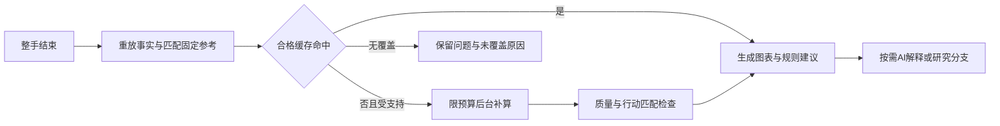

# 手后图表、EV损失与建议：工作流、Agent和数据来源研究

执行后更新（2026-11-27）：用户随后已授权推进至本轮验收；实际工程、测试、数据门和未完成范围见[AF本轮交付](riverline-auto-feedback-delivery-2026-11-27.md)。下文“仅研究/均未实施”为执行前检查点，后续状态以交付逐项记录为准。

日期：2026-11-27（Asia/Shanghai）。状态：**研究与任务设计，未实施新能力**。本轮用户要求研究理想服务、固定流程与AI Agent取舍，以及可靠翻前范围数据；不将上一轮“执行”自动扩大为本轮接入外部服务或开发授权。

配套：[任务包](riverline-auto-feedback-task-design-2026-11-27.md)、[真实用户试用](riverline-user-trial-2026-11-27.md)、[AR1实际交付](riverline-auto-review-delivery-2026-11-26.md)。下文“建议”“目标”都不表示已经获得数据、完成求解或通过性能验收。

## 1. 结论与产品目标

采用**固定分析流程负责数值和报告，受控Agent负责追问与扩展研究**。第一份有用报告应不依赖LLM；用户结束一手即能看到图表、原行动与参考行动、可评价决定的EV差、覆盖状态和有依据的建议。用户不必先编辑双方范围或填写研究表单。

当前主要缺口是可信策略数据、跨街条件范围、翻牌与后续下注模型，以及报告与研究的使用连续性。引入Agent不能替代这些能力。应先交付一个有可靠参考、覆盖明确且可重复验证的训练范围，再扩大自由整手和六人覆盖。

建议保留两种练习：

| 模式 | 用户获得什么 | 分析保证如何建立 |
|---|---|---|
| 标准策略练习 | 在已发布参考包支持的规则、节点和行动树内练习，结束自动出图表与建议 | 开始前预检所需策略/EV/续街覆盖；对手按固定参考策略行动；仅为实际覆盖的训练声明可评分 |
| 自由整手练习 | 保留现有HU/六人、启发式/实验Bot和自由合法行动 | 每个决定独立匹配；精确匹配、近似研究、未覆盖分别呈现，树外行动保留原额，不冒充全手有答案 |

标准练习不能只限制按钮却没有后续答案。若参考包只覆盖某个翻后子局面，就明确从该节点开始，不能标成完整翻前到河牌练习。对于允许的行动及后续发牌，需要有真实续街参考或可兑现的后台求解路径；未验收前不承诺全局覆盖。

## 2. 固定流程与Agent的分工

| 工作 | 首选实现 | 原因/边界 |
|---|---|---|
| 规则重放、身份与金额、行动前快照 | 规则引擎＋确定性代码 | 需要精确重现原事实 |
| 匹配数据包、更新范围、选择受支持模型 | 类型化规则与版本化策略 | 可审计、可重播，缺数据时能明确拒绝 |
| 查表、调度求解、取消/恢复、质量检查 | 固定工作流 | 预算与状态可预测，不由LLM临时决定报告能否生成 |
| EV差、频率、覆盖统计、图表 | 同一固定结果的程序计算 | 防止文字、图表与原解出现不同数值 |
| 首屏简短建议 | 证据驱动规则/模板 | 不依赖网络、API Key或自然语言模型可用性 |
| “为什么这张转牌改变策略”等追问 | 有引用的AI解释 | 基于固定数据回答；只有权益数字时不能声称已经证明阻断效应或因果 |
| 比较紧/松范围、替代下注树、挑选研究问题 | 受控Agent调用既有命令 | 可提出并执行有预算的研究分支，分支结果单独保存 |
| 编造缺失EV、推测对手底牌、用语言模型充当Solver | 不采用 | 不能作为数值或评价依据 |

这是本项目的架构判断。Anthropic官方将预定代码路径的workflow与模型动态决定工具路径的agent区分，并指出已知步骤适合可预测流程，开放问题才更需要Agent灵活性；增加自主性通常还要付出成本与延迟。[官方说明](https://www.anthropic.com/research/building-effective-agents)

建议先实现不含LLM的完整主流程，随后增加“解释这手”单次结构化生成，最后再增加有限工具循环。后两者都不改变原报告的权威数值；不需要同时引入复杂Agent框架。现有教学Agent脚本也不能被描述成已接入真实LLM。

## 3. 现有代码复核

本轮只读核对以下实现，未修改它们：

- `src/modules/play/review.ts`：`referenceRanges`使用tight/standard/wide三组固定牌类，加入Hero牌类后展开组合；不是按位置和公开历史得到的条件范围。`autoConfiguration`拒绝翻前/翻牌，并将自动转牌的`riverBets`设为`[0,0]`。
- `runtime/game/auto-review.ts`：已拥有手后排队、SQLite报告缓存、质量状态及唯一真实服务调用。应扩展此链，不建立第二个报告事实库。
- `src/modules/analysis/real-domain.ts`：现有EV口径是bb、当前节点、已投入为沉没成本、无抽水。不能直接混入其他来源的折叠基准EV或抽水结果。
- `engines/rules/helper.py`与`src/modules/play/domain.ts`：当前练习100BB默认、0 ante、50/100盲注；报告与求解口径为无抽水。数据包第一组应精确匹配这套条件。
- `runtime/bots/baseline.ts`：现有基础Bot为启发式，不能将GTO参考动作直接称为“对这个Bot的最佳回应”。冻结HU候选也没有整体强度证明。
- `engines/postflop/Cargo.toml`：固定postflop-solver提交，关闭默认特性，现有采用为单线程；有28个逻辑处理器也不代表现有原生适配器会自动多线程。
- `runtime/store.ts`：`commit`向journal追加完整运行时状态。扩充策略库/自动报告前须处理制品索引与快照膨胀，不能把完整策略树放进每次状态提交。

## 4. “可靠翻前范围”究竟需要哪些数据

一张RFI开池图只能回答某位置未有人入池时的部分问题。完整复盘至少还要覆盖面对开池、跟注、3-bet/4-bet、SB limp及防守等实际路径；还要知道每个候选动作的价值。

| 数据层 | 最小内容 | 能支持什么 |
|---|---|---|
| 规则/模型元数据 | 桌型、每座筹码、位置、盲注/ante/straddle、抽水比例/封顶/时点、现金局或ICM、允许尺度与后续模型 | 判断是否匹配当前练习 |
| 节点/行动树 | 稳定路径、行动者、精确raise-to和增投、可选动作、到达关系 | 找到用户的原决定，避免仅按“BTN对BB”猜节点 |
| 策略 | 每组合/牌类每行动的混合频率，原始精度与索引 | 展示参考动作并传播范围 |
| 行动EV | 各可选动作在同一节点、同一手牌、同一延续策略下的EV及原点 | 计算模型内行动EV差；仅有频率不能算EV损失 |
| 来源与质量 | 引擎/版本、原始设置、抽象与采样、运行质量、可重现制品与校验值、允许用途 | 复核可靠性、更新与追责 |
| 跨街交接 | 翻前出口的条件范围及后续策略依据，兼容/相关性处理 | 以有来源范围启动翻后分析 |

牌类展示应保留到具体组合的可追溯展开。对子、同花、非同花组合数不同，不能把169格等权平均当范围频率。只给牌类策略时，要明确其是否满足同类花色对称，不能假装已经拥有1326个独立组合的原始EV。

数据可信度需要分别评估：来源可复核、规则匹配、行动路径匹配、范围派生可复核、模型覆盖、数值质量。不能用一个绿色“verified”掩盖其余几项。

## 5. 数据来源调查与采用顺序

本轮只查询官方资料，未购买、下载付费库、运行候选产品或取得再发行许可。下表是可行性筛选，官方能力描述不是本项目独立正确性或性能证据。

| 来源/路线 | 本轮查到的依据 | 对本项目的取舍 |
|---|---|---|
| HRC Pro离线生成 | 官方现金局文档支持ChipEV及抽水配置；v3文档描述翻后下注抽象、范围出口和包含策略/EV的JSON导出 | **优先做小样本可行性验证**。核对当前版本样本格式、深筹后续模型、收敛/采样与输出使用权；不能把树构建脚本误当可无人值守求解服务API |
| 有明确许可的专业预解包/供应商合作 | 可采购目标规则的固定树、策略、行动EV与元数据；本轮未拿到满足合同的具体包 | 可能最快形成标准练习。先索取样本与使用范围，确认完整路径/EV/授权，禁止只买图片后宣称完整数据层 |
| GTO Wizard | 官方文档有自定义翻前、规则设置与范围导出；普通服务条款限制商业使用其范围/树/图表及自动请求 | 适合作为经允许的人工对照来源；**不作为默认批量采集后端**。合作/API及制品使用权需单独核实，Benchmark API也不等于产品数据API |
| PioSOLVER | 官方UPI可读节点范围、策略、EV并估算树内存；提供离线自动化研究接口 | 候选交叉验证工具与HU数据生成路线。不是六人翻前能力证据，也不是现有原生适配器已可直接读取的格式；许可/版本和实际样本另验 |
| 开源/公开图表与短码Nash表 | 需逐份查来源、规则、授权及是否带EV/行动树；本轮没有找到并验收覆盖100BB HU/六人的完整可发行包 | 可做特定教材或独立小模型校验。push/fold数据不能用于100BB有limp/raise/call的整手评价 |
| 现有三档参考或AI生成范围 | 只有公开假设定义 | 保留为探索性研究，不能升级命名为可靠翻前均衡库 |

依据：[HRC现金局配置](https://www.holdemresources.net/docs/cashgame/)、[HRC v3模型与导出](https://www.holdemresources.net/blog/2023-hrc-v3-release/)、[HRC树构建脚本](https://www.holdemresources.net/docs/scripting/)、[GTO Wizard翻前能力](https://blog.gtowizard.com/introducing-multiway-preflop-solving/)、[范围导入导出](https://help.gtowizard.com/how-to-build-custom-solutions/)、[GTO Wizard条款7.5/7.7](https://lp.gtowizard.com/terms/)、[Pio UPI](https://site.piosolver.com/docs/upi/commands/)。

推荐双轨准备：开发与数据样本格式先行；同时确认离线自生成或专门许可的数据获取方式。普通软件购买、允许导出、允许自动化以及允许将结果随产品提供，是不同条件，分别记录；不能预设购买订阅就全部满足。本轮不代用户购买或联系供应商。

## 6. 跨街范围不能每街重置

对公开历史`h`，在条件允许且采用同一固定策略时，行动更新概念上为：

`w_next(c) ∝ w_previous(c) × strategy(action | c, h)`

这表示按参考策略条件化，并不证明对手真的按该策略行动。发牌再排除冲突组合并按机会概率更新；双方私牌兼容性和公共路径需要在联合分布中正确处理，不能独立归一化两个数组后丢失相关性。

关键约束：

1. 翻前沿**完整公开行动**走到翻牌，不只挑一张按位置命名的表。
2. 翻后行动需要该节点的策略才能继续传播；只有翻前表时，无法据此准确得到转牌/河牌条件范围。
3. 实际动作不在树内、参考概率为0、Hero组合不在支持集时，保留“树外/参考不可达”。不能加一个很小的概率、自动塞入Hero牌类或就近匹配下注后再声称精确评价。
4. 可以建立明确标注的探索性新范围/离树重求分支，但它是新假设；不能静默覆盖原参考。无条件重求也不自动等于理论上安全的子博弈求解。
5. 六人弃至两人仍有弃牌条件相关性与bunching问题。两人翻后求解不等于六人整手均衡；完整多人还需单独模型和验证。
6. Hero选定组合的局部评价不能让对手策略获得Hero私牌；不能使用实际对手底牌或未来公牌推断当时范围。

首轮建议HU、100BB、无抽水/ante的一个固定配置；六人翻前单独数据包、单独验收，不从HU范围扩写。

## 7. EV损失的口径与建议资格

在同一参考、节点、玩家、具体组合和延续策略下，定义：

`decisionGapBb = max_a Q_reference(I, c, a) - Q_reference(I, c, chosen)`

这里比较的是已建模候选动作。候选不完整、原金额树外、数据无行动EV、范围不可达、结果未满足质量门时，不能展示确定的“本次损失”。低频行动不自动判错；混合行动可能价值相同；数值噪声附近应表达“差异未稳定区分”。

- **实际输赢**是本手结算，不是决策质量，也不是全押权益EV。
- **节点参考EV差**是该参考模型内的行动比较，不是对未知对手的真实期望亏损。
- **已评价决定差值合计**若后续开放，必须带覆盖分母、共同评价协议和逐项来源；缺失不填0，混用独立局部模型不能包装为整手损失。
- **真实整手价值差**需要定义完整联合参考/对手策略和一致的反事实延续，并通过独立账本及数值门。本轮设计不预设已有这项能力。
- 求解器全局NashConv/可利用性不是某个稀有组合EV误差的通用置信区间。不得直接把它当每节点“±误差”；需要重复运行、预算扩大及独立对照来检测建议是否稳定。

建议基于证据分级：直接显示“参考模型偏好什么及差多少”；范围/树变化会翻转时显示条件性；只有对照分析支持时才写“这张牌导致…”。无数据时显示下一步可执行的研究路径，不能用流畅文字掩盖空缺。

上一轮真实试用的4♦6♠手牌，转牌28.3%价格、约28.8%参考权益与约+0.046bb跟注EV只属于原有限范围/河牌过牌模型。新流程必须重新得到合格来源后再分析，不能把旧数值贴成全街升级后的答案。

## 8. 报告应如何直接服务用户

结束一手即显示报告摘要，下一手仍易到达；完整牌桌成为辅助回放，不把分析埋在牌桌下方。

1. 顶部：本手结算、已评价决定数/全部可评价候选数、待算/未覆盖数、当前最值得看的一个决定；有多少Hero决定可计入EV差明确显示。
2. 四街时间线：可点评原行动；已算出EV差用条形图，未覆盖/待算用独立状态；没有数据的街道没有0损失柱。
3. 决策卡：原选择、候选行动EV、参考混合频率、可用范围与完整/缺失行动、质量和条件说明。频率条和EV条分别表达。
4. 一至三条建议：对应明确决定和数据证据，可点开“为什么/在什么条件下改变”。
5. 深入研究：保留原问题、同手/同决定/同解/同路径/同Hero；高级范围表单默认折叠；首先展示原决定。返回保持上下文。
6. 继续练习：使用可生成且有参考的同主题定义；原手重打、已见变体和独立新题分别登记暴露。

会话趋势图只汇总同口径的合格指标，显示样本数与覆盖率；不把低覆盖率造成的低合计损失宣传成进步。

## 9. 性能方案与实测边界

本轮只读取硬件：Intel i7-14700HX，20物理核心/28逻辑处理器，物理内存约15.7GiB。未运行新的翻前/翻牌求解或响应时间测试。现有原生采用单线程；后续启用并行需要新证据，不能把核心数直接换算成提速比例。

Pio官方硬件文档对其传统实用翻前树给出64GB以上内存建议；这一产品特定且包含历史背景的说明支持“先离线生成/预解”的路线判断，不能用来证明本机、HRC或其他引擎所有翻前局面都算不动。[硬件文档](https://site.piosolver.com/docs/faq/hardware/)

推荐流程：

查表/缓存键包括规则、完整公开前缀、范围来源/权重、树、质量/引擎和版本；Hero组合是查询维度，不得因缓存复用混淆来源。花色同构只有完整范围/牌面/行动和私牌映射满足条件且往返验证后才采用，禁止按粗牌面桶复用为精确解。

简化优先级：预计算和复用同街同解 → 限制声明支持的规则/训练范围 → 减少有证据的下注尺度 → 限预算后台计算并分步呈现 → 可选深度研究。删掉后续河牌下注、截断范围或近似匹配尺寸都会改变问题，必须独立标记与评估；减少图表或加LLM不能弥补这些精度变化。

现有128×128转牌及AR1小样本速度不代表真实全范围翻牌性能。扩容量需要按真实范围、树和质量实测RSS、时间、持久化/恢复与查询，而不是只放宽schema上限。GPU价值依赖具体采用引擎，当前不规划购买硬件或训练神经价值网络。

## 10. 尚待证实的事项

- 尚无取得并验收的100BB完整可发行翻前策略/行动EV包；HRC/Pio当前格式与输出使用条件仍需样本验证。
- 未证明目标翻牌树能在本机预算内完成；本轮没有性能达标结论。
- 未交付跨街条件范围、真实翻牌适配、完整转牌延续、全局EV损失或真实LLM Agent。
- 本文形成可执行分析与任务依赖，不把资料阅读等同求解正确性或新能力交付。
