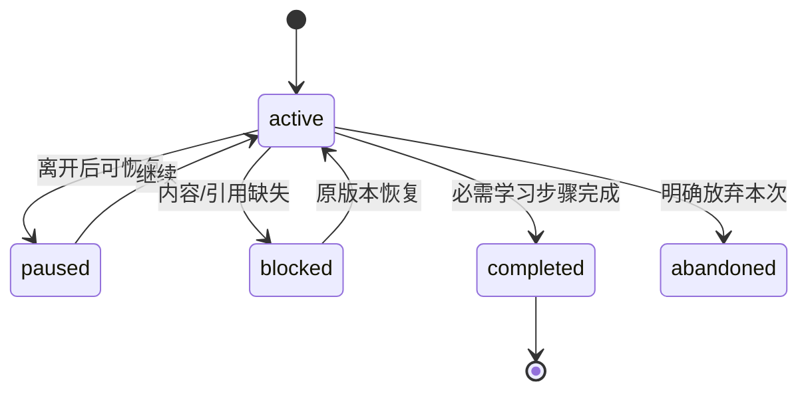

# 教学升级轮 T1：产品与交互设计 v0.1

日期：2026-11-12（Asia/Shanghai）。状态：本轮设计审阅稿；尚未开发。用户本轮指令是“开始下一轮设计”。本文件将上一轮[教学方向建议](teaching-product-redesign.md)具体化，不改变第一版交付历史。

配套：[内容规格](teaching-v2-content-spec.md)、[领域与契约](teaching-v2-contracts.md)、[开发任务与验收](teaching-v2-task-design.md)。四份文件共同构成 T1 设计；旧 D01–D08 仍由原任务文件解释。

## 1. 本轮要解决的用户问题

学习者能从自己的具体手牌出发，理解其在当前范围中的角色，检验条件变化，再在未揭示答案的新题独立作答。产品需要明确保存“我原先怎么想、看过什么、为什么修改、新题做得怎样”。

T1 必须交付两个完整教学包，而不是再增加一批孤立页面：

| 教学包 | 核心目标 | 最终可见成果 |
|---|---|---|
| LP-A 翻前行动怎样形成翻后范围 | 读懂位置/前序行动、相对范围权重、Open/3-bet/4-bet 分支与翻后衔接 | 一条带范围来源的行动线、局部策略作品、独立迁移记录 |
| LP-B 同一牌类为何需要比较具体组合 | 区分真实牌面事实、示意策略、范围组成及可验证的解释 | 近邻组合对照、后续牌预测、有边界的结论、独立迁移记录 |

对象是理解基本德州扑克规则、正在学习范围的用户。规则入门与任意局面的实时指导不属于本轮。

## 2. 范围决定

| 本轮实际开发目标 | 本轮保持边界 |
|---|---|
| 两包各有完整引导课、自由研究出口、三道迁移题和一道延迟题 | 课程是概念/流程演示，不宣称真实 GTO 教学效果 |
| Hero 纯行动预测、3–6 组合局部构建、范围骨架与来源显示 | Hero 任意合法尺度及混合频率继续暂缓；已有范围混频保留 |
| 一条有限翻前树，包含 Open、3-bet、4-bet 与匹配翻后节点 | 不承诺所有位置、筹码或任意树；省略行动明确标为树未建模 |
| 两个受控对照、一个反例、一个连续决策片段/包 | 不接真实 Solver、LLM、牌型/规则引擎，不补全未知数值 |
| 内容检查器、完整版本/暴露/评价/复测/导入恢复 | 内容通过自写资产和校验发布；不做完整可视化 CMS 或真实教练权限 |
| 教学 Agent 的提示/证据/实验/复习脚本与复盘出口 | 不替用户完成独立作答，不把心理误解当作已诊断事实 |

原研究、旧训练和 S01–S10 仍可使用。S08 保留历史预览身份，新增 LP-A 的课程研究数据，不将旧 S08 的索引数值改名当新教材。库页面增加真实的街道/形式过滤，移除固定“翻牌 · 现金局”标签，承接 PF02。

## 3. 学习目标及证据要求

| 目标 ID | 可观察行为 | 内容包与证据 |
|---|---|---|
| LO01 条件识别 | 指出当前行动方、前序行动、底池、剩余筹码和允许动作 | LP-A 条件题与路径题；金额依据账本 |
| LO02 范围形成 | 区分初始权重与行动后保留权重，找到当前范围来源 | LP-A 权重示意题；只评价声明的单玩家条件示意 |
| LO03 范围联系 | 从 Hero 找到近邻组合与行动类别，区分两种统计分母 | 两包的局部作品与分母题 |
| LO04 证据解释 | 区分牌面事实、作者示意和待检验假说；指出适用条件 | LP-B 对照及反例；理由文本保留待审阅 |
| LO05 条件迁移 | 条件变动后重新判断，不照搬旧结论或旧数值 | 每包三题迁移池及一道延迟题 |
| LO06 连续计划 | 保存连续节点的选择并追溯上游影响 | 两包各一个限定片段；结束时注明“片段结束” |

每个目标显示“尚无作答 / 有辅助证据 / 有本次无辅助证据 / 有新题或复测证据”，同时列样本数和来源身份。禁止显示“已掌握 GTO”“预计胜率提升”。概念题通过也不等于策略数值可靠。

## 4. 两条入口

**引导学习**：首页“继续学习 / 选择课程” → 目标和条件 → Hero 预测 → 证据与近邻 → 局部范围 → 条件对照/反例 → 连续片段 → 总结 → 迁移 → 复习。

**自由研究**：局面库或课程“自由研究此例” → 原 Solver 工作台 → 参考/范围/节点/实验。可以直接看参考，系统记录相应暴露；转入课程时不假定用户没见过答案。

默认首页主入口为继续教学进度，次入口为自由研究；已经存在的研究不会隐藏。课程页面增加在训练中心中的“引导课程”页签，原四类专项练习保留在“专项练习”。不新增顶级“Solver 参数”“课程引擎”等内部菜单。

## 5. 页面与导航

| 地址（拟） | 内容 | 离开/返回行为 |
|---|---|---|
| `/learn` | 两包目录、目标、内容身份、继续/重新开始 | 重新开始创建新 run，不覆盖旧作品 |
| `/learn/:runId` | 当前阶段、范围工作区、证据和主行动 | 恢复到已保存阶段；回看已完成阶段不改最初作答 |
| `/practice/:sessionId` | 复用现有页面，承载迁移/复测/局部专项 | 带课程/题目版本与来源返回链接 |
| `/study/:caseId` | 原研究工作台，新增教学来源与范围来源抽屉 | 跳回课程原阶段；返回不撤销已经发生的暴露 |
| `/progress?objective=…` | 按目标查看作答、新题、提示、暴露和复习 | 不将旧未标注题目回填成新课程证据 |
| `/content` | 教学内容检查器，仅教练演示入口 | 看目录/版本/校验/来源和停用状态；不作为真实权限 |
| `/review` | 原复盘，提取节点后可匹配课程或提示无覆盖 | 显示匹配依据；原始牌谱事实不改写 |

新问题用明确的题目引用跳转；不再依赖某个页面组件临时猜题。未知地址/删除对象显示保存状态与返回入口。

## 6. 教学工作区结构

```text
课程名 · 内容身份 · 固定版本              [自由研究] [Agent]
目标：本次能解释什么                 进度 3/8 · 已保存
位置/前序行动/底池/筹码/牌面/当前行动方
────────────────────────────────────────────────────
阶段导航       当前学习任务                  证据/解释
目标与条件     两张 Hero 牌                  观察
我的预测       当前可用动作                 理论条件
近邻与范围     3–6 个关键组合或类别          对照/反例
条件对照       当前指定评分范围             来源/限制
连续片段       用户/给定/参考来源图例         [逐级提示]
总结与迁移
────────────────────────────────────────────────────
我的理由 / 信心（可跳过）        [保存草稿] [提交本步]
```

未揭示阶段右栏只展示题干和输入解释，不渲染答案、未来牌、参考频率、解释结论、缩略图、颜色暗示或可解出答案的统计。授权投影在命令查询层完成，不靠 CSS 隐藏。

1440/1280 使用三栏或可折叠证据栏；1024 左栏收起、证据抽屉化，主动作保持可达。窄屏保证阅读与基础输入，不承诺完整范围编辑效率。保留双牌面、四色设置、键盘选择和焦点恢复；错误不只用红绿区分。

## 7. 各阶段的具体交互

| 阶段 | 主问题和输入 | 提交后发生什么 |
|---|---|---|
| 条件 | “现在轮到谁？哪些行动是树中已提供的？”选择/排序题 | 记录条件作答；给账本和动作边界反馈 |
| Hero 预测 | 选固定树动作，可填理由/不确定/信心 | 固定预测；动作选择本身不在无可靠解时判战略对错 |
| 近邻证据 | 点选三个对照组合，回答可验证的花色/范围问题 | 记录概念题，开放对应证据；未配对数值不显示 |
| 局部构建 | 在明确的 3–6 组合目标集内分配动作，支持纯行动快捷填、已有混频控件 | 仅检查要求集合；“未要求”不是“漏填”；示意分布比较单列 |
| 条件实验 | 先预测，再选“打开对照”；检查改动清单 | 基准和变体固定；缺条件时阻止比较并保留预测 |
| 反例 | 判断原结论是否仍适用，定位失效条件 | 使用明确概念答案，不自动评判自由文本含义 |
| 连续片段 | 每个节点作答后进入下一已覆盖节点 | 预定教学路线与用户行动不符时进入已有分支或明确结束，不悄悄改用户动作 |
| 总结 | 写一句“在……条件下，我观察到……”并可勾选不确定项 | 固定总结版本，给出证据链接，生成迁移会话 |
| 迁移 | 三道池中按规则取未暴露题，题干隐藏答案 | 提交后反馈；新题不足时显示不足，不换标题伪造新题 |
| 复测 | 后续本地到期队列 | 新建 Attempt，旧作答保持；不创建系统提醒或外部自动任务 |

条件与 Hero 预测合并为第一阶段，两个对照合并为一个阶段，按内容规格形成 8 个核心阶段；上表把子任务分别展开说明。进入目标阶段允许跳过理由、信心或选择“我不确定”，但必须显式提交规定题项才能解锁下一步。允许“直接看证据”，其结果是保存当前草稿、记录跳过与暴露，再进入辅助学习；不得替用户生成原预测。

## 8. 状态与独立身份



阶段状态为 `not-started / editing / committed / skipped / revealed`，固定作答另存。课内部分可辅助、部分可无辅助；不以整个课程一个布尔值替代逐次 Attempt 身份。

界面并列显示三个维度：**本次辅助状态、应用内答案暴露、任务类型（原题重做/迁移/延迟复测）**。例如“本次未用提示 · 已见过对应答案 · 原题重做”。无法核实外部经验时不显示“从未见过”。

读研究答案、含答案的知识说明、Agent 提示及导入包中的历史答案均纳入相关作用域。课程 A/B 共享的翻后例不会因为换了课程 ID 就重新变成未见题；仅改题干或规则版本也不能绕过暴露记录。

## 9. 反馈展示合同

一次反馈是多张有身份的卡片，不给混合总分：

- **结构**：需要填写的集合、概率合计、死牌与条件是否一致。
- **概念**：确定性答案判定及说明，例如范围来源、底池账本或公开牌事实。
- **示意分布对照**：仅当题目明确练习作者样例分布时显示，标题为“与作者示意分布的差异”，不称 GTO 准确率。
- **动作价值**：T1 两个教学包默认不提供战略 EV 评分；原研究页的配对模拟数值仍可按原身份展示。
- **解释**：保存用户文本，展示引用是否齐全、条件选项是否匹配；不通过关键词命中伪装理解评判。
- **后续学习**：基于明确题项错误推荐一题，说明规则与样本局限。候选误解不能直接写为诊断。

提示前可见“使用后标为辅助”；一个提示或同题答案揭示对当前 Attempt 的影响不可撤销。后续不相关题不自动继承辅助，但相关暴露和学习历史仍保存。

## 10. 范围与连续路径的呈现

输入范围、单玩家行动后示意权重、用户作品、参考示意四者有独立图例。每条范围来源链可打开：初始版本 → 本玩家行动频率 → 保留权重 → 公共死牌过滤。没有 joint matchup/移除效应计算，必须持续说明简化。

单点研究中的类别内行动比例与行动内类别占比各自标分母。零分母显示无数据；重叠类别不堆叠成 100%。分类事实使用审阅后的固定清单，不复用旧索引标签。

连续片段有两种模式：引导模式每节点提交后看反馈；测验模式片段结束后统一反馈。两者在开始前选择，过程中不能切换仍保留“独立片段”的名称。遇到未覆盖路径保存当前作答并结束为“未覆盖”，不补出对手行动或未来牌。

## 11. Agent、知识与复盘

教学 Agent 本轮提供四个透明意图：“解释输入”“给一个提示”“展开本步证据”“根据记录安排复习”。条件实验通过现有研究命令生成固定分支。每次调用显示实际操作与成果引用，未知语言意图只说明支持范围。

独立题只能解释通用输入，不能调用会返回答案的 Solver/知识正文/课程答案工具。请求具体提示时，先记录辅助再返回提示。提交后解释逐条绑定证据，缺少依据显示缺失。取消/暂停/预算仍沿用原任务语义。

复盘提取节点后按明确输入签名和允许条件匹配教学包。匹配时展示“相关课程”而非“你犯了某种错误”；不匹配保留研究草稿，可打开概念说明，不把其他牌面的结论贴上来。

## 12. 内容检查器与异常

内容检查器显示：身份、作者/审阅声明、包/规则/依赖版本、发布状态、内容校验项、题目用途、解释引用与禁用原因。用户可预检/导入自有内容副本并查看问题；未知作者自报“已审阅”不自动成为内置可信包。完整自由编辑器、审批协作和真实权限不在 T1。

| 异常 | 用户看到和能做什么 |
|---|---|
| 未覆盖的条件/行动 | 保留输入和作答，说明缺哪一项，返回已覆盖节点或自由研究 |
| 包或依赖版本缺失 | 原作答/原文只读可导出；不替换为新版同名题 |
| 未提交输入离开 | 继续编辑或明确放弃；已提交预测不受影响 |
| 任务中断 | 当前内容版本和步骤恢复；已完成命令不重复产生作品 |
| 存储不可用 | 内存状态、导出入口，绝不显示伪保存成功 |
| 迁移池无未暴露题 | 显示“当前无新的迁移题”，允许标注身份重做，不伪生成新题 |
| 原题修改/重新开始 | 新 run/新 Attempt，首次证据及暴露仍在 |

## 13. 本轮完成条件

两个包均能完成“目标→预测→证据→局部范围→对照/反例→连续片段→总结→迁移→本地复测”，每个主按钮有成果和来源。用户无需先填写整范围；翻前有可操作连续树和翻后衔接；所有实际表现有固定引用和准确身份。

只有研发后完成对应旅程与机制验证，才可将本设计的“必须”记为已实现。设计完成不代表内容资产已编写、审核、发布或教学效果已验证。
